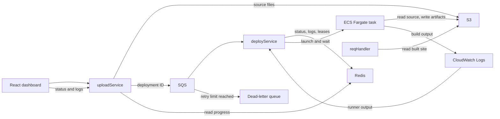

# Cygnus

Paste a Git URL, watch the build, open the preview. Cygnus is a self-hosted deployment platform for static frontends. The control services can run locally while each build runs in its own AWS Fargate task.

## How a deploy works



- The upload API clones the repository, saves its source under `output/<id>/`, and queues the ID. A repo with a `package.json` needs an npm build script that writes to `dist/`. A plain HTML repo can be published directly.
- The worker uses SQS long polling and renews message visibility while the build runs. A Redis lease coordinates duplicate deliveries. SQS is acknowledged after the artifacts are uploaded and the deployment is marked `deployed`. Failed deliveries can be retried, then routed to the dead-letter queue.
- Each Fargate task gets an IAM role scoped to its deployment's S3 prefixes. The worker stores the launch token and task ARN in Redis so a later delivery can resume tracking the same task. Build output goes to CloudWatch. With `ECS_LOG_GROUP` set, the worker reads the task's CloudWatch stream and appends npm output to the dashboard's Redis log feed.
- The preview server reads the deployment ID from the hostname and serves objects from `dist/<id>/` in S3.

## Run it locally

Install Node.js 24, Docker, and the AWS CLI. Start Docker, then run this from the repo root to start Floci and Redis and write `.env.floci`:

```sh
./scripts/setup-local.sh
```

Run each line in its own terminal from the repo root:

```sh
cd uploadService && npm ci && npm run build && node --env-file=../.env.floci dist/index.js
cd deployService && npm ci && npm run build && node --env-file=../.env.floci dist/index.js
cd reqHandler && npm ci && npm run build && node --env-file=../.env.floci dist/index.js
cd frontend && npm ci && npm run dev
```

Open [localhost:5173/deploy](http://localhost:5173/deploy) and submit a trusted test repo. The preview has the form `http://<id>.localhost:3001/`. Floci emulates S3 and SQS for this workflow. Builds run in the local worker process.

For a hosted dashboard, set `VITE_UPLOAD_API_URL` and `VITE_PREVIEW_DOMAIN` before building the frontend. Use a bare domain for `VITE_PREVIEW_DOMAIN`. The backend and wildcard preview routes need to be reachable from the browser.

## Run builds on AWS

Use a private S3 bucket and a Standard SQS queue with a dead-letter queue. Set the source queue's `maxReceiveCount` to 3 for the retry behavior used in this demo. Create a root `.env` and load it from each backend directory with `node --env-file=../.env dist/index.js`.

```dotenv
AWS_PROFILE=your-aws-profile
AWS_REGION=ap-southeast-2
BUCKET=your-private-bucket
REDIS_URL=redis://127.0.0.1:6387
SQS_QUEUE_URL=https://sqs.ap-southeast-2.amazonaws.com/123456789012/your-build-queue
BUILD_BACKEND=fargate
ECS_CLUSTER=your-cluster
ECS_TASK_DEFINITION=arn:aws:ecs:ap-southeast-2:123456789012:task-definition/your-runner:1
ECS_SECURITY_GROUP=your-security-group-id
ECS_SUBNET_ID=your-public-subnet-id
ECS_LOG_GROUP=your-cloudformation-LogGroup-output
```

The upload service needs S3 writes to `output/` and SQS send access. The worker needs SQS receive, delete, visibility, and queue lookup permissions, plus ECS task launch and describe access. It also needs to create, tag, manage inline policies for, pass, and remove task roles under `/cygnus-builds/`, and to pass the runner's execution role. The preview service needs S3 reads under `dist/`.

For dashboard build output, give the worker's AWS identity `logs:GetLogEvents` on `arn:aws:logs:<region>:<account-id>:log-group:<log-group-name>:log-stream:build/runner/*`. Set `ECS_LOG_GROUP` to the stack's `LogGroup` output. This enables log forwarding for the task definition in this repo, which uses the `build` stream prefix and the `runner` container. The worker keeps reading briefly after the task stops to pick up late log lines.

For a local worker using AWS, set `BUILD_BACKEND=local`. For R2 storage, set `ENDPOINT`, `ACCESS`, and `SECRET` for the S3-compatible client. SQS still uses AWS credentials.

### Build and publish the runner image

[The CloudFormation template](deployService/fargate.yaml) sets up an ECS cluster, an ECR repository, a runner task definition, and a CloudWatch log group. Set `AWS_PROFILE` and `AWS_REGION` for your account. Provide a bucket, VPC, and an existing test deployment ID under `output/<id>/`. The template uses that ID for its standalone smoke test.

```sh
IMAGE_TAG=v1
aws cloudformation deploy --stack-name cygnus-fargate-build \
  --template-file deployService/fargate.yaml --capabilities CAPABILITY_IAM \
  --parameter-overrides BucketName="$BUCKET" DeploymentId="$DEPLOYMENT_ID" VpcId="$VPC_ID" ImageTag="$IMAGE_TAG"

aws cloudformation describe-stacks --stack-name cygnus-fargate-build \
  --query 'Stacks[0].Outputs' --output table
```

Set `REPOSITORY_URI` from the stack output and push the ARM64 build image. Use a new image tag for each image change.

```sh
aws ecr get-login-password | docker login --username AWS --password-stdin "${REPOSITORY_URI%%/*}"
docker build --platform linux/arm64 -t "$REPOSITORY_URI:$IMAGE_TAG" deployService
docker push "$REPOSITORY_URI:$IMAGE_TAG"
```

Copy the cluster, full task definition ARN, and security group into `.env`. Choose a public subnet in that VPC. Restart the worker and submit a repo to try the full flow. The Fargate task stops when the build finishes. The dashboard, API, worker, Redis, and preview server have to be hosted separately for a public end-to-end demo.

## Test the queue flow

Once Floci and Redis are up, run this from the repo root:

```sh
cd deployService
SQS_TEST_ENDPOINT=http://127.0.0.1:4566 SQS_TEST_REDIS_URL=redis://127.0.0.1:6387/14 npm run test:sqs
```

The tests cover acknowledgements, duplicate deliveries, retries, heartbeats, and dead-letter handling.
